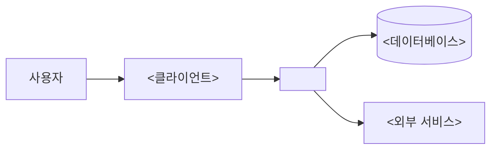

# 아키텍처

- 마지막 갱신: YYYY-MM-DD

> 시스템이 어떤 부분으로 이루어져 있고 서로 어떻게 연결되는지 설명한다. 새로 온 사람이 코드를 열기 전에 전체 그림을 잡는 것이 목적이다.
> 개별 기능의 설계는 `docs/spec/NNN-<기능>/plan.md`에, 결정의 이유는 ADR에 쓰고 여기서는 링크만 건다. 확인되지 않은 내용은 `미확인`으로 표시한다.

## 개요

<시스템이 하는 일과 전체 구조를 2~3줄로>

## 구성도

## 구성 요소

| 구성 요소 | 역할 | 위치 | 기술 |
|---|---|---|---|
| <API 서버> | <요청 처리, 비즈니스 로직> | `<src/api/>` | <프레임워크> |

## 주요 흐름

<핵심 시나리오 1~3개를 단계별로>

1. <예: 사용자가 로그인하면 클라이언트가 API에 토큰을 요청한다>
2. <API가 DB에서 사용자를 확인하고 토큰을 발급한다>

## 데이터

- 저장소: <DB 종류와 주요 테이블 또는 컬렉션>
- 데이터가 오가는 경계: <외부로 나가거나 들어오는 데이터>

## 외부 의존성

| 서비스 | 용도 | 장애 시 영향 |
|---|---|---|
| <외부 API, 결제, 인증 등> | <용도> | <영향> |

## 배포 구조

실행 환경, 배포, 운영은 [인프라](infra.md)에 쓴다.

## 주요 결정

- <결정 요약> — [ADR-NNN](../adr/ADR-NNN-<결정>.md)
