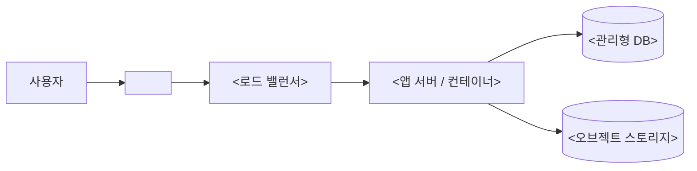

# 인프라

- 마지막 갱신: YYYY-MM-DD

> 시스템이 어디서, 어떻게 돌아가고 배포되는지 설명한다. 구성 요소와 연결 관계는 `docs/design/architecture.md`에 쓰고 여기서는 실행 환경만 다룬다.
> 비밀번호, API 키, 토큰 같은 비밀값은 절대 쓰지 않는다. 보관 위치만 적는다. 확인되지 않은 내용은 `미확인`으로 표시한다.

## 개요

<어디서 돌아가는지 2~3줄로. 예: 클라우드 종류, 리전, 컨테이너·서버리스 여부>

## 환경

| 환경 | 용도 | URL | 배포 트리거 |
|---|---|---|---|
| <개발> | <로컬 개발, 기능 확인> | `<URL>` | <예: 수동> |
| <스테이징> | <운영 전 검증> | `<URL>` | <예: main 병합> |
| <운영> | <실제 사용자> | `<URL>` | <예: 태그 푸시> |

## 구성도

## 리소스

| 리소스 | 서비스 종류 | 환경 | 관리 방식 |
|---|---|---|---|
| <앱 서버> | <예: ECS, Cloud Run, VM> | <운영, 스테이징> | <IaC 경로, 예: `infra/app.tf` 또는 수동> |

## 네트워크와 도메인

- 도메인과 DNS: <도메인, DNS 관리 위치>
- TLS 인증서: <발급·갱신 방식>
- 공개 경계: <외부에 열린 것과 내부 전용인 것>

## 배포

- CI/CD 도구: <예: GitHub Actions, `.github/workflows/<파일>.yml`>
- 파이프라인 단계: <예: 테스트 → 빌드 → 이미지 푸시 → 배포>
- 롤백 방법: <이전 버전으로 되돌리는 절차>

## 설정과 비밀값

| 항목 | 보관 위치 | 주입 방식 |
|---|---|---|
| <예: DB 접속 정보> | <예: Secrets Manager, GitHub Secrets> | <예: 환경 변수> |

## 모니터링과 알림

- 로그: <어디서 보는지>
- 지표: <어디서 보는지, 주요 지표>
- 알림: <조건과 받는 사람·채널>

## 백업과 복구

| 대상 | 주기 | 보관 기간 | 복구 절차 |
|---|---|---|---|
| <운영 DB> | <예: 매일> | <예: 7일> | <절차 또는 문서 링크> |
