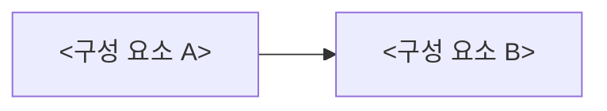

# RESEARCH-NNN: <조사 주제, 예: "기존 WorkNX 스택과 PRD의 관계">

- 상태: 진행 중 / 완료 / 결정됨(→ `ADR-NNN`)
- 조사 질문: <이 문서를 쓰게 만든 질문 원문>
- 작성일: YYYY-MM-DD
- 마지막 갱신: YYYY-MM-DD
- 출처: <근거로 삼은 코드, 문서, 명령 결과와 기준 시점>

> 구조 분석, 기술 조사, 비교, 추천처럼 "조사해서 알아낸 것"을 남기는 문서다. 한 문서에는 조사 질문 하나만 다룬다. 따라 하는 절차는 guide 문서에 쓰고 여기서는 링크만 건다.
> 구조는 github/awesome-copilot의 technical spike 템플릿(MIT)을 바탕으로 했다. 확인한 사실에는 근거(경로, 명령)를 붙이고, 확인하지 못한 내용은 `미확인`, 미루어 짐작한 내용은 `추정`으로 표시한다.
> 추천을 실제로 채택하면 ADR을 쓰고, 이 문서의 상태를 `결정됨`으로 바꿔 ADR을 링크한다.

## 요약

> 결론을 먼저 쓴다. 무엇을 알아냈고, 그래서 무엇을 하면 되는지 2~3줄로 쓴다.

<요약>

## 조사 질문

> 답하려는 질문을 쓴다. 주 질문은 하나, 세부 질문은 필요한 만큼 쓴다.

**주 질문:** <질문>

**세부 질문:**

- <질문>

## 배경과 범위

> 왜 조사하는지, 어떤 구성 요소와 관련 있는지, 어떤 제약이 있는지 쓴다. 이번에 보지 않은 것도 적어 범위를 분명히 한다.

- **왜:** <조사가 필요한 이유, 이 결과로 정할 것>
- **관련 구성 요소:** <서버, 저장소, 기능 명세 등>
- **제약:** <읽기 전용, 운영 서버, 비밀값 제외 등>
- **범위 밖:** <이번에 보지 않은 것>

## 조사 결과

> 알아낸 사실을 주제별 소제목으로 나눠 쓴다. 구조는 그림(`flowchart`, 시간 순서는 `sequenceDiagram`)을 먼저, 사실은 표로 쓰고 근거 열을 둔다.

### <주제>

| 항목 | 확인 결과 | 근거 |
|---|---|---|
| <항목> | <결과> | <경로, 명령> |

## 결론과 추천 *(선택)*

> 조사 결과로 무엇을 하면 좋은지 쓴다. 단순히 구조를 파악한 조사라 추천할 것이 없으면 이 섹션을 지운다.

### 추천

<추천 내용>

### 이유

<추천한 이유, 검토한 대안과 고르지 않은 이유>

### 후속 조치

- [ ] <할 일, 예: ADR 작성, guide 문서 작성, 기능 명세 갱신>

## 주의점 *(선택)*

> 헷갈리기 쉬운 점, 잘못 알기 쉬운 점, 하면 안 되는 일을 쓴다.

- <오해> → <사실>

## 미확인과 결정 필요

> 조사로 답하지 못한 질문과 사람이 정해야 할 것을 쓴다. 없으면 "없음"이라고 쓴다.

- <질문>

## 관련 문서

- 따라 하기: <`../guide/GUIDE-NNN-<할 일>.md` 링크>
- 관련 조사: <`RESEARCH-NNN-<주제>.md` 링크>
- 결정 기록: <`../../adr/ADR-NNN-<결정>.md` 링크>
- 외부 자료: <공식 문서 링크>
